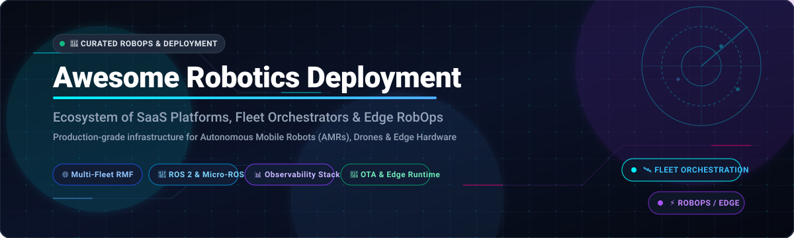
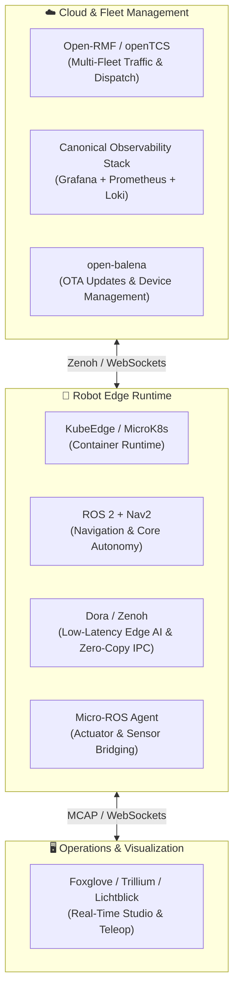

# 🤖 Awesome Robotics Deployment

### 🚀 Top SaaS Platforms & Open-Source Fleet Orchestration Ecosystem

**A community-curated collection of commercial SaaS platforms, RobOps infrastructure, and open-source projects for deploying, monitoring, and orchestrating heterogeneous robot fleets at scale.**

*Focusing on Fleet Orchestration, Edge Deployment, Robot Operations (RobOps), OTA Updates & Real-Time Observability.*

---

## 📑 Table of Contents

- [🌐 Overview](#-overview)
- [📈 Sector Overview & Market Dynamics](#-sector-overview--market-dynamics)
- [🏢 SaaS & Hosted Fleet Platforms](#-saas--hosted-fleet-platforms)
- [💻 Open-Source GitHub Projects](#-open-source-github-projects)
- [🏗️ Recommended Architectural Blueprints](#️-recommended-architectural-blueprints)
- [🤝 How to Contribute](#-how-to-contribute)
- [💖 Support & Community](#-support--community)
- [⭐ Star History](#-star-history)
- [⚖️ Disclaimer](#️-disclaimer)

---

## 🌐 Overview

Deploying robotics in production requires vastly different infrastructure than traditional web applications. Robotics teams face harsh edge computing environments, intermittent connectivity, hardware-level safety constraints, heterogeneous device fleets (AMRs, quadrupeds, robotic arms, drones), and massive sensor bandwidth (LiDAR, point clouds, video streams). 

This repository tracks the leading **SaaS platforms** and **open-source ecosystems** that solve these challenges — handling:
- 🛰️ **Fleet Orchestration & Traffic Scheduling:** Multi-robot coordination across facilities, dynamic task assignment, and obstacle conflict management.
- ⚡ **Robot Operations (RobOps) & Diagnostics:** Remote teleoperation, health telemetry, diagnostics, and incident response.
- 🔄 **Edge Deployment & OTA Runtime:** Containerized Over-the-Air updates, firmware rollouts, and deterministic offline autonomy.
- 📊 **Multimodal Observability:** Time-series telemetry, MCAP sensor logs, rosbag capture, and Grafana-based monitoring.

---

## 📈 Sector Overview & Market Dynamics

The dedicated **robot fleet management and RobOps software market** is estimated at **$1.6B to $2.1B** in 2025–2026 and is projected to reach **$2.9B+ by 2027**, growing at a rapid CAGR of **~18%** within the broader **$20B+ logistics and autonomous robotics deployment ecosystem**. 

The sector is **heavily fragmented** rather than a winner-take-all market. Modern enterprise facilities deploy diverse, multi-vendor fleets combining AMRs, robotic arms, quadrupeds, and AGVs across competing hardware OEMs (such as KUKA, Boston Dynamics, Clearpath, Addverb, and Omron). Consequently, deployment orchestration requires hardware-agnostic middleware, open interoperability standards (such as ROS 2 and Open-RMF), and hybrid edge-to-cloud architectures, preventing single-vendor monopolization and fueling a vibrant ecosystem of specialized SaaS and self-hosted solutions.

---

## 🏢 SaaS & Hosted Fleet Platforms

The table below lists the category-leading commercial SaaS platforms for robot operations, fleet management, and edge deployment, sorted by **Company Size / Valuation (descending)**:

| Platform / Product | Company Size & Valuation | Starting Pricing Tier | Free Tier Limits | Key Focus & Capabilities |
| :--- | :--- | :--- | :--- | :--- |
| **[DroneDeploy (Ground / Rocos)](https://www.dronedeploy.com/)** | **Valuation: ~$500M+** • Total Funding: $157M+ • ARR: ~$55M+ | **$159 / month** *(Ag Lite / Core annual plan; Ground Robotics fleet starts at ~$250/robot/mo)* | **14-day free trial** • Full platform & Ground fleet features • Up to 10 project uploads/maps • No credit card required | Unified aerial drone and ground robot fleet orchestration (Spot quadrupeds, AMRs, 360 cameras), autonomous reality capture, site intelligence, and remote inspection. |
| **[Apex.AI](https://www.apex.ai/)** | **Valuation: ~$200M** • Total Funding: $75M • Est. Revenue: ~$12M+ | **~$1,500 / month** *(Developer seat & evaluation tier license)* | **30-day evaluation trial** • Access to Apex.OS & Apex.Grace SDKs • Simulation testing for up to 3 engineers • Technical support onboarding | Functional safety-certified (ISO 26262 ASIL D) robotics middleware and automotive operating system based on ROS 2 for mission-critical software-defined vehicles and autonomous systems. |
| **[Foxglove](https://foxglove.dev/)** | **Valuation: ~$180M** • Total Funding: $58.7M • ARR: ~$4M+ | **$20 / month** *(Pro Plan: 3 dev seats, 1 TB cloud storage; unlimited free basic seats)* | **Free forever ($0/mo)** • 3 developer seats • 10 GB cloud storage • 5 connected fleet devices | Robotics data platform and visualization suite; centralizes temporal multi-modal telemetry (LiDAR, point clouds, images, ROS/ROS 2 logs), MCAP recording, and remote debugging. |
| **[SVT Robotics](https://svtrobotics.com/)** | **Valuation: ~$100M** • Total Funding: $36.5M • Est. Revenue: ~$9M+ | **~$1,250 / month** *(SOFTBOT Connector subscription per site)* | **30-day guided pilot trial** • Virtual SOFTBOT Connector Studio access • Simulation integration sandbox for 1 site • Pre-deployment consultation | Enterprise Integration Platform-as-a-Service (iPaaS) connecting warehouse management systems (WMS, ERP) with heterogeneous AMR fleets and automated storage retrieval systems (ASRS). |
| **[RGo Robotics](https://www.rgorobotics.com/)** | **Valuation: ~$75M** • Total Funding: $21.5M • $10M+ OEM Design Wins | **~$850 / month** *(Evaluation development kit & software license)* | **30-day OEM evaluation trial** • Perception Engine SDK & runtime • Virtual robot simulation testing • Validated for up to 2 evaluation units | AI-powered artificial perception engine for mobile robots and AGVs; provides centimeter-level indoor/outdoor localization, sensor fusion, and plug-and-play perception hardware reference designs. |
| **[Formant](https://formant.io/)** | **Valuation: ~$60M** • Total Funding: $45M • Est. Revenue: ~$6M+ | **$0 / month** *(Developer)* **~$250 / robot / month** *(Commercial fleet)* | **Free forever ($0/mo)** • 1 developer device • Live ROS telemetry streaming • Full remote teleoperation & SSH | Cloud RobOps platform providing multi-device telemetry dashboards, live video streaming, low-latency teleoperation, bulk device provisioning, custom alerting, and uptime analytics. |
| **[InOrbit](https://www.inorbit.ai/)** | **Valuation: ~$37M** • Total Funding: $12.75M • Est. Revenue: ~$3M+ | **$0 / month** *(Free Edition)* **$50 / robot / month** *(Standard Edition based on MAR)* | **Free forever ($0/mo)** • Unlimited connected robots • Core InOrbit Agent & diagnostics • Basic 2D map tracking & incidents | Hardware-agnostic robot operations (RobOps) platform supporting ROS 1, ROS 2, and custom fleets; features adaptive diagnostics, Time Capsule incident playback, and Open-RMF traffic bridges. |
| **[MOV.AI](https://www.mov.ai/)** | **Valuation: ~$35M** • Total Funding: $18.4M • Est. Revenue: ~$4.7M+ | **~$500 / robot / month** *(Robotics Engine Platform licensing)* | **30-day developer evaluation** • Full MOV.AI Flow visual IDE access • AMR navigation & fleet simulation • 1 virtual AMR deployment instance | End-to-end Robotics Engine Platform for Autonomous Mobile Robots (AMRs); visual ROS-based drag-and-drop development IDE, simulation testing, and multi-robot fleet dispatching. |
| **[Freedom Robotics](https://www.freedomrobotics.ai/)** | **Valuation: ~$25M** • Total Funding: $17M • Est. Revenue: ~$2M+ | **$75 / robot / month** *(Standard Tier starting rate)* | **14-day full-featured trial** • Up to 3 connected robots • Real-time teleoperation & controls • Sensor stream recording & alerts | Edge agent and cloud management platform for remote robot control, real-time video streaming, health monitoring, and automated alerts for autonomous systems. |
| **[Cogniteam (Nimbus)](https://www.cogniteam.com/)** | **Valuation: ~$20M** • Total Funding: $9.9M • Est. Revenue: ~$3.8M+ | **$5 / user / month** *(Starter)* **$30 / robot / month** *(Device Agent)* | **14-day free trial** • Full Nimbus cloud workspace access • Simulation package execution • Up to 2 connected test devices | Low-code cloud robotics development and fleet deployment suite; features drag-and-drop ROS/ROS 2 component blocks, containerized edge deployment, and cloud simulation. |

---

## 💻 Open-Source GitHub Projects

Open-source tooling empowers robotics teams to build custom fleet management, self-host operations, maintain absolute data ownership, and avoid proprietary vendor lock-in.

The list below features the top active open-source robotics deployment and infrastructure repositories, sorted by **GitHub Stars (descending)**:

1. **[LeRobot](https://github.com/huggingface/lerobot)**   
   Hugging Face's state-of-the-art machine learning library for real-world robotics in PyTorch. Includes pretrained models, standardized imitation learning datasets, hardware-accelerated training utilities, and production pipelines for deploying Vision-Language-Action (VLA) models on real edge robots.

2. **[Autoware](https://github.com/autowarefoundation/autoware)**   
   The world's leading open-source software stack for autonomous driving and mobile robot fleet deployment. Built natively on ROS 2 with complete, production-ready modules for high-precision 3D localization, perception, path planning, and vehicle drive-by-wire control.

3. **[KubeEdge](https://github.com/kubeedge/kubeedge)**   
   CNCF incubating Kubernetes Native Edge Computing Framework. Extends native containerized orchestration to robotics edge devices, delivering bidirectional edge-cloud messaging, MQTT device twins, zero-downtime application deployment, and continuous offline autonomous operation during network dropouts.

4. **[ROS 2](https://github.com/ros2/ros2)**   
   The industry-standard Robot Operating System middleware. Powers modern commercial robot fleets with DDS-based inter-process communication, real-time safety lifecycles, cross-platform hardware support (Linux, Windows, macOS, RTOS), and modular package deployment.

5. **[Nav2 (Navigation 2)](https://github.com/ros-navigation/navigation2)**   
   The de facto autonomous navigation, path planning, and fleet execution framework for ROS 2. Enables Autonomous Mobile Robots (AMRs) to navigate dynamic warehouse, logistics, and hospital environments with sophisticated behavioral trees, costmap 2D/3D layers, and collision avoidance.

6. **[Dora (dora-rs)](https://github.com/dora-rs/dora)**   
   Ultra-fast, low-latency robotics dataflow framework and distributed edge orchestrator written in Rust. Features zero-copy shared-memory transport and Apache Arrow columnar memory formats with polyglot node support across Rust, Python, C, and C++ for high-performance edge AI pipelines.

7. **[Zenoh](https://github.com/eclipse-zenoh/zenoh)**   
   Zero-overhead pub/sub, shared memory, and distributed storage protocol purpose-built for robotics and edge computing. Delivers sub-microsecond latencies, native ROS 2 bridges (`rmw_zenoh`), and ultra-low bandwidth consumption across noisy industrial Wi-Fi and 5G connections.

8. **[Iceoryx](https://github.com/eclipse-iceoryx/iceoryx)**   
   Eclipse Foundation's true zero-copy inter-process communication (IPC) middleware designed for safety-critical autonomous systems. Enables deterministic, zero-copy payload transmission for high-throughput robotic sensor deployments (high-res cameras, LiDAR, and radar).

9. **[Awesome Robotics](https://github.com/ahundt/awesome-robotics)**   
   Extensive, established curated list of robotics software libraries, perception algorithms, simulators, learning resources, and academic tools across robotics domains.

10. **[open-balena](https://github.com/balena-io/open-balena)**   
    Open-source platform for deploying and managing connected IoT and robotics edge devices. Enables container-based over-the-air (OTA) updates, secure remote SSH tunneling, environment variable management, and centralized fleet rollouts for embedded Linux robots.

11. **[Lichtblick](https://github.com/lichtblick-suite/lichtblick)**   
    BMW-maintained open-source visualization and robotics data inspection suite for ROS and ROS 2. Provides desktop and web interfaces for inspecting real-time sensor streams, point clouds, TF transforms, and diagnostics.

12. **[MCAP](https://github.com/foxglove/mcap)**   
    Modular, high-performance container file format for robotics and multimodal temporal data. Designed for zero-copy streaming, fast indexing, self-contained schemas (Protobuf, ROS msg, JSON Schema), and robust write-throughput on edge robot hardware without data corruption.

13. **[openTCS](https://github.com/openTCS/opentcs)**   
    Open-source Transport Control System for coordinating fleets of automated guided vehicles (AGVs) and AMRs in factories and logistics facilities. Provides vehicle routing, collision-free traffic scheduling, order dispatching, and hardware communication abstractions.

14. **[Micro-ROS Arduino](https://github.com/micro-ROS/micro_ros_arduino)**   
    Pre-compiled micro-ROS client library for microcontrollers (ESP32, Teensy, STM32, Arduino). Enables resource-constrained edge sensor nodes and motor controllers to participate natively as first-class ROS 2 nodes.

15. **[Open-RMF](https://github.com/open-rmf/rmf)**   
    Open Robot Management Framework by Open Robotics. Standardized multi-fleet traffic scheduling, task allocation, building infrastructure integration (elevators, automatic doors), and vendor-neutral interoperability for fleets operating in shared spaces (airports, hospitals, warehouses).

16. **[Awesome Open Source Robots](https://github.com/stephane-caron/awesome-open-source-robots)**   
    Comprehensive curated collection of open-source robot hardware, arms, mobile manipulators, quadrupeds, humanoids, and bipedal platforms with full mechanical blueprints and open firmware.

17. **[Micro-ROS Agent](https://github.com/micro-ROS/micro-ROS-Agent)**   
    Middleware gateway bridging resource-constrained micro-ROS microcontrollers into standard ROS 2 DDS networks across Serial, UDP, and TCP edge interfaces.

18. **[Transitive](https://github.com/transitiverobotics/transitive)**   
    Full-stack open-source robotics framework with fine-grained access control. Integrates ClickHouse for historical time-series data, Grafana for visual dashboards, Alertmanager for alerting, and full-stack reactive device management on self-hosted Docker Compose.

19. **[Foxglove WebSocket Protocol](https://github.com/foxglove/ws-protocol)**   
    Lightweight, high-speed binary WebSocket communication protocol for streaming ROS 1, ROS 2, and custom robot telemetry directly to web dashboards, visualization apps, and operator teleoperation clients.

20. **[Open-RAIL](https://github.com/CMCC-TAO/open-rail)**   
    Middleware from China Mobile linking Vision-Language-Action (VLA) and World-Action Models (WAM) to physical robot actuators via a 3-thread asynchronous pipeline (observation, inference, control) with real-time online smoothing.

21. **[SONNY OS](https://github.com/JackTrainer/Sonny)**   
    Ultra-lightweight microkernel built in Rust and Zenoh for robotic hardware abstraction. Features WebAssembly (WASM) sandboxing for hot-swappable skill execution and real-time hardware watchdog monitors.

22. **[Trillium](https://github.com/RobotnikAutomation/trillium)**   
    Free, open-source web and desktop robotics visualization and control app by Robotnik. Fork of Foxglove Studio v1.87.0 featuring a 40% smaller web app and 23% smaller desktop binary footprint.

### 🌟 Specialized & Emerging RobOps Frameworks

- **[OpenRobOps (ORO)](https://www.inorbit.ai/)** — InOrbit's open-source robot operations and fleet management layer, designed to provide a self-hostable fleet manager for ROS developers and native Open-RMF coordination.
- **[NexusOS](https://pypi.org/project/nexusos-robotics/)** — Universal OS and fleet middleware for heterogeneous robots, providing zero-dependency hardware abstraction, Protobuf/gRPC transports, and glassmorphic 2D pose teleoperation dashboards.
- **[Canonical Observability Stack (COS)](https://ubuntu.com/blog/roscon-2025)** — Fully open-source observability infrastructure for ROS 2 devices using Ubuntu, Grafana, Prometheus, and Loki for remote ros2bag logging, device telemetry, and automated fleet alerts.

---

## 🏗️ Recommended Architectural Blueprints

For engineering teams building a robust, self-hosted robotics deployment platform, we recommend composing the following proven open-source stack:

- **Fleet Orchestration:** Use **Open-RMF** or **openTCS** for vendor-neutral traffic scheduling and building automation (elevators/doors).
- **Edge Deployment & OTA:** Use **open-balena** or **KubeEdge** for containerized OTA releases and fail-safe firmware rollouts.
- **Communication & IPC:** Use **Zenoh** for low-bandwidth edge-to-cloud telemetry and **Iceoryx** for on-device zero-copy sensor pipelines.
- **Observability & Diagnostics:** Combine **MCAP** file recording with **Canonical Observability Stack** (Grafana/Loki/Prometheus) and **Foxglove/Lichtblick/Trillium** for visualization.

---

## 🤝 How to Contribute

Contributions from the robotics community are warmly welcome!

1. 🍴 **Fork the repository**.
2. 🌿 **Create a feature branch**: `git checkout -b add-tool-name`.
3. 📝 **Add or update entries**: Follow the established table or list format with factual, neutral descriptions, links, and pricing details.
4. 📬 **Submit a Pull Request**: Include a brief rationale and links to official documentation or source code.

Please ensure all product details remain factual, concise, and linked to canonical sources.

---

## 💖 Support & Community

Thank you for visiting **Awesome Robotics Deployment**! If you find this curated ecosystem directory helpful for your robotics architecture, RobOps initiatives, or research:

- ⭐ **Star this repository** to help other robotics engineers and operators discover it.
- 🍴 **Fork and contribute** your favorite robotics deployment tools and updates.
- 📢 **Share it** across robotics forums, ROS meetups, and LinkedIn.
- ☕ **Support the maintainer**: If you would like to support ongoing maintenance and curation of open-source robotics resources, please consider buying a coffee via the [GitHub Sponsor Dashboard](https://github.com/sponsors/ishandutta2007). Your support is greatly appreciated!

---

## ⭐ Star History

---

## ⚖️ Disclaimer

- This is an independent, community-curated list and does not constitute an endorsement of any commercial platform or open-source software.
- Production robotics deployments involve safety-critical operations, functional safety standards (e.g., ISO 13849, ISO 26262), and regulatory compliance. Always test deployment, fail-safe, and OTA mechanisms thoroughly in hardware-in-the-loop (HIL) environments prior to live facility operation.
- Self-hosted open-source software requires dedicated infrastructure management, hardening, and network security.
